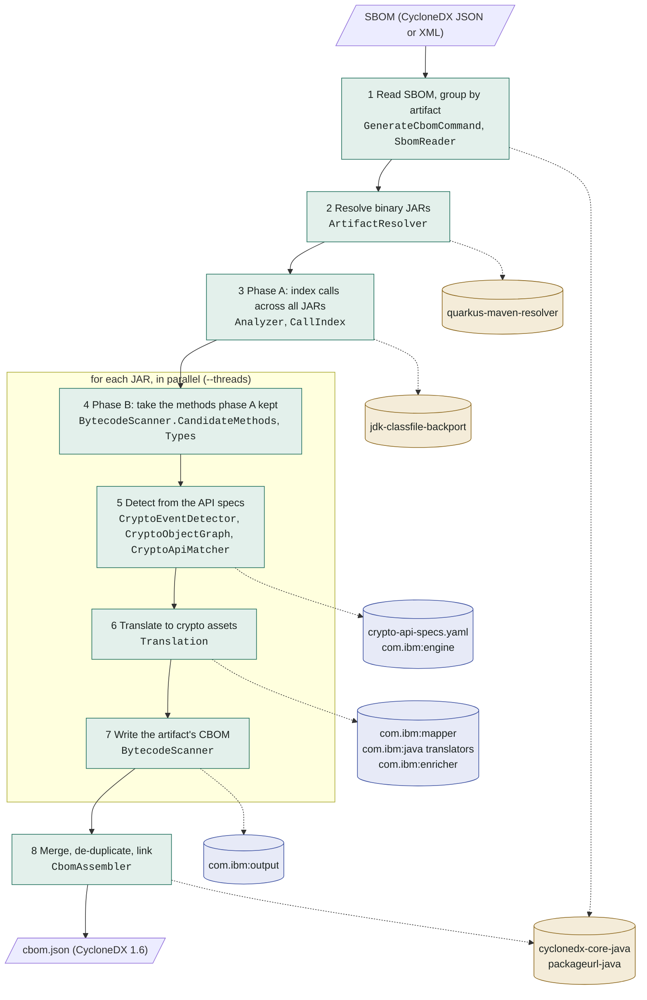

# Architecture

How cryptid turns a CycloneDX SBOM into a CBOM, which class runs each step, and which classes of other libraries it relies on. The class counts come from the shipped, tree-shaken runner JAR, so they show what is reachable, not what is declared. Measured on 2026-11-08 with sonar-cryptography 1.7.0 and Quarkus 3.40.1.

No SonarSource analyzer under the Sonar Source-Available License (SSALv1) is on the classpath; see [Licensing](../README.md#licensing).

## Input and output

**Input**: a CycloneDX SBOM, JSON or XML.

- Components with a `pkg:maven/…` purl of type `jar` (the default) or `test-jar` are analyzed; `pom` components are dropped, other types skipped.
- The `dependencies` graph supplies the classpath for supertype lookups (`--classpath deps`).
- `metadata.component` becomes the CBOM's root.

**Output**: a CycloneDX 1.6 CBOM.

- `metadata.component` is a shallow copy of the SBOM root; `metadata.tools` names cryptid and sonar-cryptography.
- `components` holds a `library` copy of every SBOM component with crypto assets, and the `cryptographic-asset` components.
- `dependencies` links each library to the assets located in it, and assets to assets (e.g. an algorithm to its key), as sonar-cryptography's builders produce them.
- An occurrence's `location` is `g/a/v[/classifier]/package/Source.java`. Its `line` is set when the class has a line number table; there is no column offset. `additionalContext` is the matched API, e.g. `javax.crypto.Cipher#getInstance(Ljava/lang/String;)Ljavax/crypto/Cipher;`.

```json
{ "type": "cryptographic-asset", "name": "AES-128-GCM",
  "evidence": { "occurrences": [
    { "location": "com.microsoft.sqlserver/mssql-jdbc/13.4.0.jre11/com/microsoft/sqlserver/jdbc/SecureStringUtil.java",
      "line": 88, "additionalContext": "javax.crypto.Cipher#getInstance(Ljava/lang/String;)Ljavax/crypto/Cipher;" } ] },
  "cryptoProperties": { "assetType": "algorithm", "oid": "2.16.840.1.101.3.4.1",
    "algorithmProperties": { "primitive": "ae", "parameterSetIdentifier": "128", "mode": "gcm" } } }
```

Keycloak 26.8.2 (`src/test/resources/keycloak-26.8.2.zip.cdx.json`): 573 Maven components, 548 distinct JARs, giving 792 crypto assets with 2,588 occurrences in 74 components. The assets are algorithms (hash, block cipher, MAC, signature, public-key encryption, KDF, AEAD, stream cipher, XOF, KEM, key agreement), related crypto material (secret, public and private keys, salts, IVs, nonces) and protocols (TLS).

## Packages

The code is in `io.github.aloubyansky.cryptid`, with dependencies going one way:

```text
cryptid             CLI, SBOM reading, CBOM assembly (GenerateCbomCommand, SbomReader, CbomAssembler)
cryptid.scan        BytecodeScanner: phases A and B for one JAR
cryptid.model       CryptoAssetModeler, AssetAssembler: event trees to asset trees
cryptid.detection   CryptoEventDetector, CryptoEvent, CryptoObjectGraph, Finding, Loc,
                    ValueFactories, CryptoContexts, KnownClasses
cryptid.spec        CryptoApiSpecs, CryptoApiMatcher: the specs and matching calls to them
cryptid.bytecode    Analyzer, AVal, CallSite, CallIndex, Types, JarCache: the analysis core

scan -> model -> detection -> spec -> bytecode
```

`bytecode` and `spec` use no sonar-cryptography types. `detection` and `model` use its value, context and node model, and its translators. The tests mirror the packages; the rule-based reference they compare with is in `cryptid.reference` (test sources only).

## Pipeline



Green: this project. Blue: sonar-cryptography modules (Apache-2.0). Beige: other libraries. Dashed: uses.

| Step | What it does | Data passed on |
| --- | --- | --- |
| 1. Read SBOM | Parses the SBOM, turns each Maven purl into a `MavenComponent` (groupId, artifactId, classifier, type, version, SBOM component), de-duplicates by bom-ref, groups components with equal coordinates, and computes each component's dependency closure. | components grouped by artifact; closure by bom-ref |
| 2. Resolve JARs | Resolves each artifact's binary JAR from the local repository or the configured remotes; artifacts that can't be resolved are logged and skipped. No sources JARs are needed. | artifact groups with their JAR |
| 3. Phase A | Interprets every method of every JAR abstractly (see below) and records each call into an analyzed class whose `String` or `int` arguments are constants or parameters of the caller, plus every class's superclass, interfaces and declared methods. For each JAR to be scanned it also keeps the methods that may contain a detection: those with a call site passing the detector's pre-check, a root rule by method name whose owner types include the call's owner or one of its supertypes (`Types`: the JAR, its classpath, the JDK). Skipped when all artifacts are cached in `--work-dir`. Keycloak: 301,754 calls between 83,314 classes, 1,958 methods kept, in about 20 s. | `CallIndex`: invoked method → call sites with argument constants; `CandidateMethods` per JAR |
| 4. Phase B | Takes the JAR's kept methods, with their call sites from the final round of phase A's field fixpoint; nothing is interpreted again. Detection finds nothing in the other methods, so the result is the same as analyzing the whole JAR. | per method: call sites with receiver, arguments and created object |
| 5. Detection | `CryptoEventDetector` matches the kept methods' calls against the crypto API specs (`CryptoApiMatcher`), builds each method's `CryptoObjectGraph`, and turns every call to a root API into a tree of `CryptoEvent`s (see below). | findings: location, call site, event tree |
| 6. Translation | `AssetAssembler` walks each event tree (attach and merge rules in its javadoc); the context translator for its type (cipher, digest, key, signature, MAC, …) turns each value into `INode`s with the string mappers of `com.ibm:mapper`, e.g. `JcaCipherMapper` for `"AES/GCM/NoPadding"`. Then the 19 Java reorganizer rules merge and move nodes, and the 17 enrichers add OIDs, default key sizes and functions. This is the order of sonar-cryptography's `JavaTranslationProcess`. | `INode` trees |
| 7. Artifact CBOM | `CBOMOutputFile` turns the nodes into CycloneDX components and dependencies; offsets and line 0 (no line table) are cleared; the result is written atomically to `work/cbom/<g>/<a>/<v>[/<classifier>].json`, which later runs reuse unless `--rescan`. | per-artifact CBOM files |
| 8. Assembly | Reads the per-artifact CBOMs, sorted for a run-independent order. Keeps an occurrence once per asset content (name without UUIDs, crypto properties), location and line, and redirects links of dropped duplicates. Assigns each asset to the components whose artifact path prefixes its occurrence locations, so a value resolved at a caller is linked to the caller's component. Adds library components, links and metadata, and writes the CBOM atomically. | the CBOM |

### Bytecode interpretation

`Analyzer` interprets each method over abstract values (`AVal`):

- up to 16 possible constants (more become "any constant"), kept in sorted order so results don't depend on the JVM run;
- a bitmask of the enclosing method's parameters the value may be passed through from;
- the call sites that may have created the object;
- whether it takes two stack slots.

Values merge at control-flow joins; static and instance fields reach a fixpoint per JAR. String constants fold through concatenation (`makeConcatWithConstants`), `toUpperCase`, `toLowerCase`, `trim`, `valueOf` and similar, and array element constants are tracked. A library's static constants resolve by field name.

### Detection

`RuleTable` indexes the root rules by method name and owner type. For each call site, the detector looks up the rules for the call's name and its owner or, for rules that don't match exact types only, the owner's supertypes; the rule's `MethodMatcher.matchKeys` then decides, including parameter types. On a match it builds a store tree as sonar-cryptography's engine does from source:

- the rule's action factory sets the store's action, e.g. the algorithm name implied by the constructor;
- each constant of a detectable argument goes through the parameter's value factory into the store, or into a child store when the parameter has `shouldBeMovedUnder`;
- depending rules are matched against the calls that created or received the argument object;
- next rules are matched against calls on the object the matched call created, e.g. `init` on the `Cipher` from `getInstance`;
- a detectable argument with several possible constants yields one finding per value, up to 16 combinations per match;
- a detectable argument passed in through the enclosing method's parameters is resolved through `CallIndex`, up to 6 caller hops, through superclasses and interfaces (a call to `T.m` reaches implementations of `m` in subtypes of `T`). Each value becomes a separate finding located at the caller, where the value is chosen.

Crypto objects are followed across the methods of a JAR (`CryptoObjectGraph`, through arguments and return values, up to 4 calls away); constant values across methods and JARs.

## What the runner JAR contains

The build produces `target/cryptid.jar`, an uber-jar tree-shaken with `quarkus.package.jar.tree-shake.mode=classes`: 10,581 classes, 19.6 MB (15,871 classes and 27.4 MB without tree-shaking, with the same CBOM output). Each class was mapped to the dependency it comes from:

| Group | Classes kept | Largest contributors (kept / in the dependency) |
| --- | ---: | --- |
| Maven resolution | 3,991 of 5,822 | guava 1,043/1,970, guice 449/460, maven-core 316/444, httpclient 296/470, sisu.inject 230/261, maven-resolver-impl 180/183, httpcore 166/253, sisu.plexus 150/167, maven-resolver-api 143/146, maven-model-builder 120/130 |
| CycloneDX I/O | 3,127 of 4,374 | jackson-databind 766/813, woodstox 706/942, cyclonedx-core-java 289/303, json-schema-validator 281/314, commons-collections4 215/615, jackson-core 210/221, commons-io 187/429, snakeyaml 138/237, stax2-api 109/125, jackson-dataformat-xml 62/64, `com.ibm:output` 11/17 |
| Crypto analysis | 1,757 of 2,259 | jdk-classfile-backport 659/676, `com.ibm:mapper` 356/399, gson 217/222 (the mapper's cipher-suite table), `com.ibm:java` 155/168, commons-lang3 150/422, `com.ibm:engine` 142/201, this project 40, `com.ibm:enricher` 21/21, sonar-analyzer-commons 12/97, `com.ibm:common` 5/6 |
| Quarkus runtime | 1,706 of 3,368 | smallrye-config 249, picocli 228, jboss-logmanager 191, quarkus-core 176, arc 171, generated 97, cdi-api 110, jboss-threads 64 |
| Not shipped | 0 | `com.ibm:rules` (only `FixtureConformanceTest` uses `InventoryRule`); `sonar-plugin-api` (provided scope) |

The sonar-cryptography classes that remain:

- **engine** (142): the rule model (`rule`, `rule.builder`), values and contexts (`model`, `model.context`, `model.factory`), `detection`, and `callstack` and `hooks`, which are reachable only because `DetectionStore` implements the hook observer.
- **java** (155): the rules under `rules.detection` (Bouncy Castle 314 roots, JCA 31, SSL 6), the context translators and `JavaReorganizerRules`.
- **mapper** (356): the `INode` model (algorithms, modes, paddings, functionality, curves), the string mappers for Bouncy Castle, JCA and SSL, and the reorganizer. The Go and pyca mappers are removed.
- **enricher** (21), **output** (11: `CBOMOutputFile` and its builders), **common** (5).

## Integration with sonar-cryptography

The tool uses sonar-cryptography's knowledge, not its engine. These are the classes that use its types, from the constant pools and signatures of the compiled classes:

| Class | sonar-cryptography types used | Why |
| --- | --- | --- |
| `CryptoEventDetector`, `ValueFactories` | `IValueFactory`, `IActionFactory`, `ResolvedValue`, `IValue`, `IAction`, the factory classes, `Mode` | turn argument constants into sonar-cryptography's values, exactly as its rules did; factories are created from the specs, with explicit class lists for tree-shaking |
| `CryptoEvent`, `CryptoContexts` | `IDetectionContext` and its context classes, `IBundle` | the context and library translation takes, created from the specs |
| `CryptoAssetModeler`, `AssetAssembler` | `IContextTranslation`, `INode`, `NodeOrigin`, `AbstractAssetCollection`, `DetectionLocation`, `Reorganizer`, `IReorganizerRule`, `Enricher` | the context translators (loaded reflectively: their signatures mention sonar-java types; class names are compile-time constants, which tree-shaking follows), node assembly, reorganizer and enricher |
| `BytecodeScanner` | `CBOMOutputFile`, `INode` | nodes to a CycloneDX BOM per artifact |
| `Loc`, and the marker `org.sonar.plugins.java.api.tree.Tree` | sonar-java's `Tree`, as an empty interface of our own | only for the tests that run sonar-cryptography's rules as a reference: two lambdas in the `JcaGCMParameterSpec` rules cast to `Tree` |
| `Analyzer`, `AVal`, `CallSite`, `CallIndex`, `JarCache`, `Types`, `CryptoApiMatcher`, `CryptoObjectGraph` | none | the analysis core and spec matching |

In the tests only: the rule-based detection (`RuleDetector`, `RuleTable`, `SonarCryptographyRules`), `StoreAccess` in sonar-cryptography's `com.ibm.engine.detection` package, `ScanContext` (sonar-plugin-api's `InputFile`), and `RuleAssetModeler` (`ITranslator`), the reference the spec-based pipeline is compared with. sonar-analyzer-commons and sonar-plugin-api are test dependencies.

## The detection rules

Walking `JavaDetectionRules.rules()` at runtime:

| Measure | Value |
| --- | --- |
| root rules | 351: Bouncy Castle 314, JCA 31, SSL 6 |
| distinct rules reachable | 2,563 (1,257 `DetectionRule`, 1,306 `MethodDetectionRule`), at most 4 levels deep |
| distinct matcher keys (owner types, names, parameter types) | 515 |
| distinct method names | 18; `<init>` in 2,411 rules, then `newInstance` 63, `init` 37, `getInstance` 33 |
| edges | 18,862 to depending-parameter rules, 1,167 to next rules |
| parameters | 1,207; 319 detectable, 187 of them moved under a child store |
| value factories | block size 139, algorithm 36, key size 31, algorithm parameter 27, MAC size 20, digest size 18, boolean 12, salt size 10, operation mode 9, others |
| action factories | 2,361 `ValueActionFactory` (the asset name comes from the rule), 8 others |
| exact-type rules | 1,337 match the owner type only, never subtypes |
| contexts | 11 used, all with Java translators |

Most information comes from which API is called, mostly Bouncy Castle constructors, rather than from argument values.
