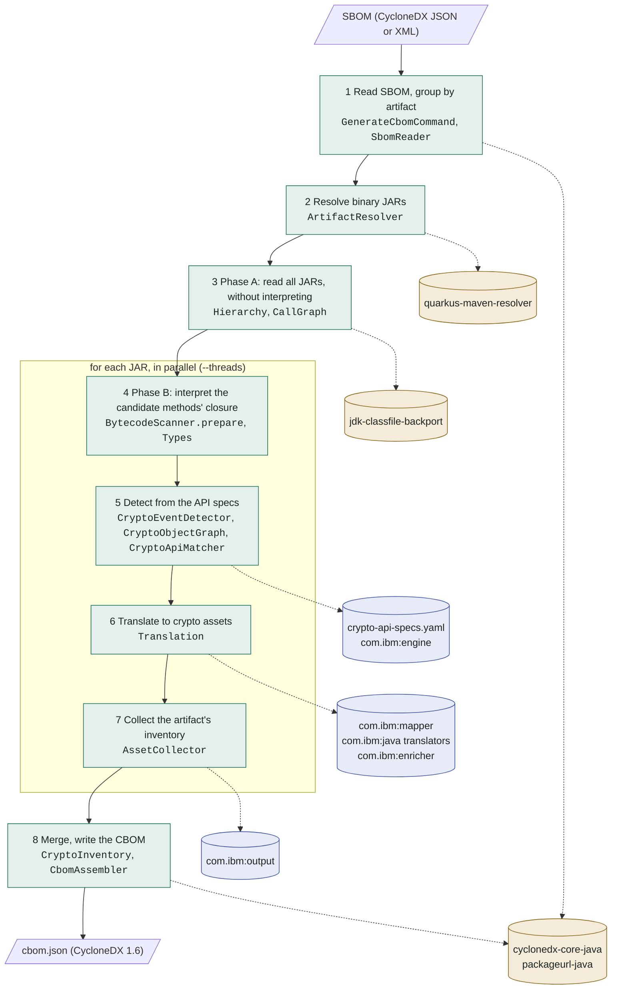

# Architecture

How cryptid turns a CycloneDX SBOM into a CBOM, which class runs each step, and which classes of other libraries it relies on. The class counts come from the shipped, tree-shaken runner JAR, so they show what is reachable, not what is declared. Measured on 2026-11-08 with sonar-cryptography 1.7.0 and Quarkus 3.40.1.

No SonarSource analyzer under the Sonar Source-Available License (SSALv1) is on the classpath; see [Licensing](../README.md#licensing).

## Input and output

**Input**: a CycloneDX SBOM, JSON or XML.

- Components with a `pkg:maven/…` purl of type `jar` (the default) or `test-jar` are analyzed; `pom` components are dropped, other types skipped.
- The `dependencies` graph says which artifacts' copies of a class an artifact prefers, for the few classes that are in several JARs with different contents.
- `metadata.component` becomes the CBOM's root.

**Output**: a CycloneDX 1.6 CBOM.

- `metadata.component` is a shallow copy of the SBOM root; `metadata.tools` names cryptid and sonar-cryptography.
- `components` holds a `library` copy of every SBOM component with crypto assets, and the `cryptographic-asset` components.
- `dependencies` links each library to the assets located in it, and assets to assets (e.g. an algorithm to its key), as sonar-cryptography's builders produce them.
- An occurrence's `location` is `g/a/v[/classifier]/package/Source.java`. Its `line` is set when the class has a line number table; there is no column offset. `additionalContext` is the matched API, e.g. `javax.crypto.Cipher#getInstance(Ljava/lang/String;)Ljavax/crypto/Cipher;`.

```json
{ "type": "cryptographic-asset", "name": "AES-128-GCM",
  "evidence": { "occurrences": [
    { "location": "com.microsoft.sqlserver/mssql-jdbc/13.4.0.jre11/com/microsoft/sqlserver/jdbc/SecureStringUtil.java",
      "line": 88, "additionalContext": "javax.crypto.Cipher#getInstance(Ljava/lang/String;)Ljavax/crypto/Cipher;" } ] },
  "cryptoProperties": { "assetType": "algorithm", "oid": "2.16.840.1.101.3.4.1",
    "algorithmProperties": { "primitive": "ae", "parameterSetIdentifier": "128", "mode": "gcm" } } }
```

Keycloak 26.8.2 (`src/test/resources/keycloak-26.8.2.zip.cdx.json`): 573 Maven components, 548 distinct JARs, giving 725 crypto assets with 4,320 occurrences in 77 components. The assets are algorithms (hash, block cipher, MAC, signature, public-key encryption, KDF, AEAD, stream cipher, XOF, KEM, key agreement), related crypto material (secret, public and private keys, salts, IVs, nonces) and protocols (TLS).

## Packages

The code is in `io.github.aloubyansky.cryptid`, with dependencies going one way:

```text
cryptid             the API: Cryptid, AnalysisInput, InputArtifact, AnalysisOptions, EntryPoint,
                    and the result model (CryptoInventory, CryptoAsset, AssetOccurrence, ...)
cryptid.cli         CLI, SBOM reading, CBOM assembly (GenerateCbomCommand, SbomReader, CbomAssembler)
cryptid.analysis    AnalysisRun: phases A and B over all artifacts, the merge, the cache
                    (CacheKey, InventoryJson), BuildInfo
cryptid.cyclonedx   API too: CbomWriter, writing an inventory as a CycloneDX CBOM
cryptid.scan        BytecodeScanner: phases A and B for one JAR; AssetCollector: sonar-cryptography's
                    output to the result model; ArtifactScan, the result of one JAR
cryptid.model       CryptoAssetModeler, AssetAssembler: event trees to asset trees
cryptid.detection   CryptoEventDetector, CryptoEvent, CryptoObjectGraph, Finding, Loc,
                    ValueFactories, CryptoContexts, KnownClasses
cryptid.reach       EntryPointDetector: entry points and instantiated classes, from the declarations
cryptid.spec        CryptoApiSpecs, CryptoApiMatcher: the specs and matching calls to them;
                    EntryPointSpecs: the entry-point and instantiation specs
cryptid.bytecode    Analyzer, AVal, CallSite, JarCache: the analysis core; DemandCallIndex,
                    Callers: values passed in from callers, interpreted on demand;
                    Hierarchy: the class table; Types: an artifact's view of it, and the JDK;
                    CallGraph, MethodFacts: the calls between all methods

cli -> cryptid (API), cryptid.cyclonedx (API) -> analysis -> scan -> model -> detection -> spec -> bytecode
cli -> cyclonedx
```

The root package holds the API; the other packages are internal. See [foundation.md](foundation.md#phase-1-api-decided-2026-11-26) for the result model and [its phase 2](foundation.md#phase-2-api-decided-2026-11-27) for the analysis API.

`bytecode` and `spec` use no sonar-cryptography types. `detection` and `model` use its value, context and node model, and its translators. The tests mirror the packages; the rule-based reference they compare with is in `cryptid.reference` (test sources only).

## Pipeline



Green: this project. Blue: sonar-cryptography modules (Apache-2.0). Beige: other libraries. Dashed: uses.

| Step | What it does | Data passed on |
| --- | --- | --- |
| 1. Read SBOM | Parses the SBOM, turns each Maven purl into a `MavenComponent` (groupId, artifactId, classifier, type, version, SBOM component), de-duplicates by bom-ref, and groups components with equal coordinates. | components grouped by artifact |
| 2. Resolve JARs | Resolves each artifact's binary JAR from the local repository or the configured remotes; artifacts that can't be resolved are logged and skipped. No sources JARs are needed. Each resolved artifact becomes an `InputArtifact` with its direct dependencies from the SBOM's graph, looking through components that aren't analyzed, such as POMs; the CLI then calls `Cryptid.analyze`, which runs steps 3 to 8 in `AnalysisRun`. | `InputArtifact`s |
| 3. Phase A | Reads every JAR's class headers and instructions, without interpreting them, into the class table (`Hierarchy`: every class with its superclass, interfaces and declared methods; of a class in several JARs with different contents, all copies) and the call graph (`CallGraph`: a type for each copy of a class, and for every method of every copy, the methods it calls and its lambdas and method references refer to, the classes it instantiates, and its callers from real calls; calls resolve to the declaring class and to the copy of it the calling artifact sees, as spec matching does, so a shaded copy calls its own copies; calls into classes outside the SBOM, such as the JDK's, aren't kept; `dispatch` works on type ids). It also reads, per artifact, the annotations the entry-point specs name (on classes, methods and parameters, with their constant values), `META-INF/services` and the manifest's `Main-Class`: for the application's artifacts every class and method with its flags, for the others only those with such annotations. `EntryPointDetector` then finds the entry points in the application's artifacts with `src/main/resources/entry-point-specs.yaml`: roots, which the runtime starts by itself, and callbacks, which the framework calls on objects that exist, such as JAX-RS sub-resource methods, entry points once their class is instantiated; and the classes instantiated without a visible `new`: beans, service providers, the classes declaring root entry points. Skipped when every artifact's result is cached and none is the application's. Keycloak: 83,299 classes, 4,393 of them in several artifacts and 6 with copies that differ; 786,908 methods, 1,221,942 calls (27,138 through method handles), 114,941 instantiations, in about 5 s; 35 root entry points in the 38 `org.keycloak` artifacts (19 HTTP methods, 14 JAX-RS locators, `main` and its `run`), 722 callbacks in 145 classes, and 1,941 instantiated classes. | class table; `CallGraph`; a `DemandCallIndex` over them |
| 4. Phase B | Per JAR, in parallel: finds the candidate methods, those calling a specified API, from the instructions (`Analyzer.methodsCalling`, matched with `Types` over the JAR's view of the class table: of a class whose copies differ, the JAR's own, else its nearest dependency's, else the first artifact's; then the JDK), and interprets them with the methods their values depend on (`Analyzer.closure`: the writers of the fields they read and the exact methods they call, transitively), which gives them the values interpreting the whole JAR would. Candidates are kept if their interpretation confirms them. Keycloak: 2,526 candidates, 8,078 methods interpreted of 777,498. | per method: call sites with receiver, arguments and created object |
| 5. Detection | `CryptoEventDetector` matches the kept methods' calls against the crypto API specs (`CryptoApiMatcher`), builds each method's `CryptoObjectGraph`, and turns every call to a root API into a tree of `CryptoEvent`s (see below). | findings: location, call site, event tree |
| 6. Translation | `AssetAssembler` walks each event tree (attach and merge rules in its javadoc); the context translator for its type (cipher, digest, key, signature, MAC, …) turns each value into `INode`s with the string mappers of `com.ibm:mapper`, e.g. `JcaCipherMapper` for `"AES/GCM/NoPadding"`. Then the 19 Java reorganizer rules merge and move nodes, and the 17 enrichers add OIDs, default key sizes and functions. This is the order of sonar-cryptography's `JavaTranslationProcess`. | `INode` trees |
| 7. Artifact inventory | `CBOMOutputFile` turns each finding's nodes into CycloneDX components, and `AssetCollector` converts them into the result model: `CryptoAsset`s identified by name and properties (`CBOMOutputFile` merges by name alone, so each finding gets an output of its own), with each occurrence mapped back to its `CodeLocation` (artifact, source file, enclosing method, line, called method), which the modeler records for every detection location it creates. The conversion fails on a property the model doesn't carry. The JAR's `ArtifactScan` is written atomically to `<cache directory>/<key>/<g>/<a>/<v>[/<classifier>].json` (`InventoryJson`), which later analyses reuse unless `rescan` is set; the CLI's `--work-dir` is the cache directory. The key (`CacheKey`) is a digest of everything a per-artifact result depends on beyond its JAR: cryptid's version, build time and specs, the classpath scope, and the coordinates, path, size, modification time and dependencies of every artifact, since callers in other JARs pass values in and other JARs resolve supertypes. A run with any of them changed analyzes everything again, in a directory of its own; nothing is deleted. | per-artifact scans |
| 8. Assembly | `AnalysisRun` merges the per-artifact scans in artifact order into one `CryptoInventory`, with an `ArtifactAnalysis` per artifact (analyzed, cached or failed): one asset per content, with all its occurrences and the union of its dependencies. `CbomAssembler` writes it with `CryptoAssetComponents`: bom-refs derived from content, the same in every run; occurrences with `location` and `line`, the enclosing method as `symbol` and the called method as `additionalContext`. Each asset is linked from the components sharing an artifact its occurrences are in, so a value resolved at a caller is linked to the caller's component: `dependsOn` where the occurrence is a use, `provides` where it is a provision (`AssetOccurrence.role()`: the occurrence's class implements a type of `crypto-implementation-specs.yaml`, a JCA SPI or a Bouncy Castle primitive or provider type, or the occurrence calls a specified crypto API of its own artifact). Adds library components, links and metadata, and writes the CBOM atomically. | the CBOM |

### Bytecode interpretation

`Analyzer` interprets each method over abstract values (`AVal`):

- up to 16 possible constants (more become "any constant"), kept in sorted order so results don't depend on the JVM run;
- a bitmask of the enclosing method's parameters the value may be passed through from;
- the parameters of other methods it may be passed through from by way of a field (`StoredParam`: the storing method and the parameter index, at most 16), e.g. a constructor's parameter kept in a field, which detection resolves from that method's callers;
- the call sites that may have created the object;
- whether it takes two stack slots.

Values merge at control-flow joins; static and instance fields reach a fixpoint per JAR, or per closure of methods within a JAR, with the same values. String constants fold through concatenation (`makeConcatWithConstants`), `toUpperCase`, `toLowerCase`, `trim`, `valueOf` and similar, and array element constants are tracked. A library's static constants resolve by field name. A method reference (`SHA256Digest::new`) is recorded as a call site of the referenced method with unknown receiver and arguments, so APIs that report by their type are detected; a lambda's body is a method of its own, with its own call sites.

### Detection

`RuleTable` indexes the root rules by method name and owner type. For each call site, the detector looks up the rules for the call's name and its owner or, for rules that don't match exact types only, the owner's supertypes; the rule's `MethodMatcher.matchKeys` then decides, including parameter types. On a match it builds a store tree as sonar-cryptography's engine does from source:

- the rule's action factory sets the store's action, e.g. the algorithm name implied by the constructor;
- each constant of a detectable argument goes through the parameter's value factory into the store, or into a child store when the parameter has `shouldBeMovedUnder`;
- depending rules are matched against the calls that created or received the argument object;
- next rules are matched against calls on the object the matched call created, e.g. `init` on the `Cipher` from `getInstance`;
- a detectable argument with several possible constants yields one finding per value, up to 16 combinations per match;
- a detectable argument passed in through the enclosing method's parameters is resolved from its callers (`DemandCallIndex`: callers found through the call graph, each interpreted as a closure in every artifact containing its class, once per run), up to 6 caller hops, through superclasses and interfaces (a call to `T.m` reaches implementations of `m` in subtypes of `T`). Each value becomes a separate finding located at the caller, where the value is chosen.

Crypto objects are followed across the methods of a JAR (`CryptoObjectGraph`, through arguments and return values, up to 4 calls away); constant values across methods and JARs.

## What the runner JAR contains

The build produces `target/cryptid.jar`, an uber-jar tree-shaken with `quarkus.package.jar.tree-shake.mode=classes`: 10,581 classes, 19.6 MB (15,871 classes and 27.4 MB without tree-shaking, with the same CBOM output). Each class was mapped to the dependency it comes from:

| Group | Classes kept | Largest contributors (kept / in the dependency) |
| --- | ---: | --- |
| Maven resolution | 3,991 of 5,822 | guava 1,043/1,970, guice 449/460, maven-core 316/444, httpclient 296/470, sisu.inject 230/261, maven-resolver-impl 180/183, httpcore 166/253, sisu.plexus 150/167, maven-resolver-api 143/146, maven-model-builder 120/130 |
| CycloneDX I/O | 3,127 of 4,374 | jackson-databind 766/813, woodstox 706/942, cyclonedx-core-java 289/303, json-schema-validator 281/314, commons-collections4 215/615, jackson-core 210/221, commons-io 187/429, snakeyaml 138/237, stax2-api 109/125, jackson-dataformat-xml 62/64, `com.ibm:output` 11/17 |
| Crypto analysis | 1,757 of 2,259 | jdk-classfile-backport 659/676, `com.ibm:mapper` 356/399, gson 217/222 (the mapper's cipher-suite table), `com.ibm:java` 155/168, commons-lang3 150/422, `com.ibm:engine` 142/201, this project 40, `com.ibm:enricher` 21/21, sonar-analyzer-commons 12/97, `com.ibm:common` 5/6 |
| Quarkus runtime | 1,706 of 3,368 | smallrye-config 249, picocli 228, jboss-logmanager 191, quarkus-core 176, arc 171, generated 97, cdi-api 110, jboss-threads 64 |
| Not shipped | 0 | `com.ibm:rules` (only `FixtureConformanceTest` uses `InventoryRule`); `sonar-plugin-api` (provided scope) |

The sonar-cryptography classes that remain:

- **engine** (142): the rule model (`rule`, `rule.builder`), values and contexts (`model`, `model.context`, `model.factory`), `detection`, and `callstack` and `hooks`, which are reachable only because `DetectionStore` implements the hook observer.
- **java** (155): the rules under `rules.detection` (Bouncy Castle 314 roots, JCA 31, SSL 6), the context translators and `JavaReorganizerRules`.
- **mapper** (356): the `INode` model (algorithms, modes, paddings, functionality, curves), the string mappers for Bouncy Castle, JCA and SSL, and the reorganizer. The Go and pyca mappers are removed.
- **enricher** (21), **output** (11: `CBOMOutputFile` and its builders), **common** (5).

## Integration with sonar-cryptography

The tool uses sonar-cryptography's knowledge, not its engine. These are the classes that use its types, from the constant pools and signatures of the compiled classes:

| Class | sonar-cryptography types used | Why |
| --- | --- | --- |
| `CryptoEventDetector`, `ValueFactories` | `IValueFactory`, `IActionFactory`, `ResolvedValue`, `IValue`, `IAction`, the factory classes, `Mode` | turn argument constants into sonar-cryptography's values, exactly as its rules did; factories are created from the specs, with explicit class lists for tree-shaking |
| `CryptoEvent`, `CryptoContexts` | `IDetectionContext` and its context classes, `IBundle` | the context and library translation takes, created from the specs |
| `CryptoAssetModeler`, `AssetAssembler` | `IContextTranslation`, `INode`, `NodeOrigin`, `AbstractAssetCollection`, `DetectionLocation`, `Reorganizer`, `IReorganizerRule`, `Enricher` | the context translators (loaded reflectively: their signatures mention sonar-java types; class names are compile-time constants, which tree-shaking follows), node assembly, reorganizer and enricher |
| `AssetCollector` | `CBOMOutputFile`, `INode` | each finding's nodes to CycloneDX, converted into the result model; the only class that sees sonar-cryptography's output |
| `Loc`, and the marker `org.sonar.plugins.java.api.tree.Tree` | sonar-java's `Tree`, as an empty interface of our own | only for the tests that run sonar-cryptography's rules as a reference: two lambdas in the `JcaGCMParameterSpec` rules cast to `Tree` |
| `Analyzer`, `AVal`, `CallSite`, `DemandCallIndex`, `Callers`, `JarCache`, `Types`, `CryptoApiMatcher`, `CryptoObjectGraph` | none | the analysis core and spec matching |

In the tests only: the rule-based detection (`RuleDetector`, `RuleTable`, `SonarCryptographyRules`), `StoreAccess` in sonar-cryptography's `com.ibm.engine.detection` package, `ScanContext` (sonar-plugin-api's `InputFile`), and `RuleAssetModeler` (`ITranslator`), the reference the spec-based pipeline is compared with. sonar-analyzer-commons and sonar-plugin-api are test dependencies.

## The detection rules

Walking `JavaDetectionRules.rules()` at runtime:

| Measure | Value |
| --- | --- |
| root rules | 351: Bouncy Castle 314, JCA 31, SSL 6 |
| distinct rules reachable | 2,563 (1,257 `DetectionRule`, 1,306 `MethodDetectionRule`), at most 4 levels deep |
| distinct matcher keys (owner types, names, parameter types) | 515 |
| distinct method names | 18; `<init>` in 2,411 rules, then `newInstance` 63, `init` 37, `getInstance` 33 |
| edges | 18,862 to depending-parameter rules, 1,167 to next rules |
| parameters | 1,207; 319 detectable, 187 of them moved under a child store |
| value factories | block size 139, algorithm 36, key size 31, algorithm parameter 27, MAC size 20, digest size 18, boolean 12, salt size 10, operation mode 9, others |
| action factories | 2,361 `ValueActionFactory` (the asset name comes from the rule), 8 others |
| exact-type rules | 1,337 match the owner type only, never subtypes |
| contexts | 11 used, all with Java translators |

Most information comes from which API is called, mostly Bouncy Castle constructors, rather than from argument values.
