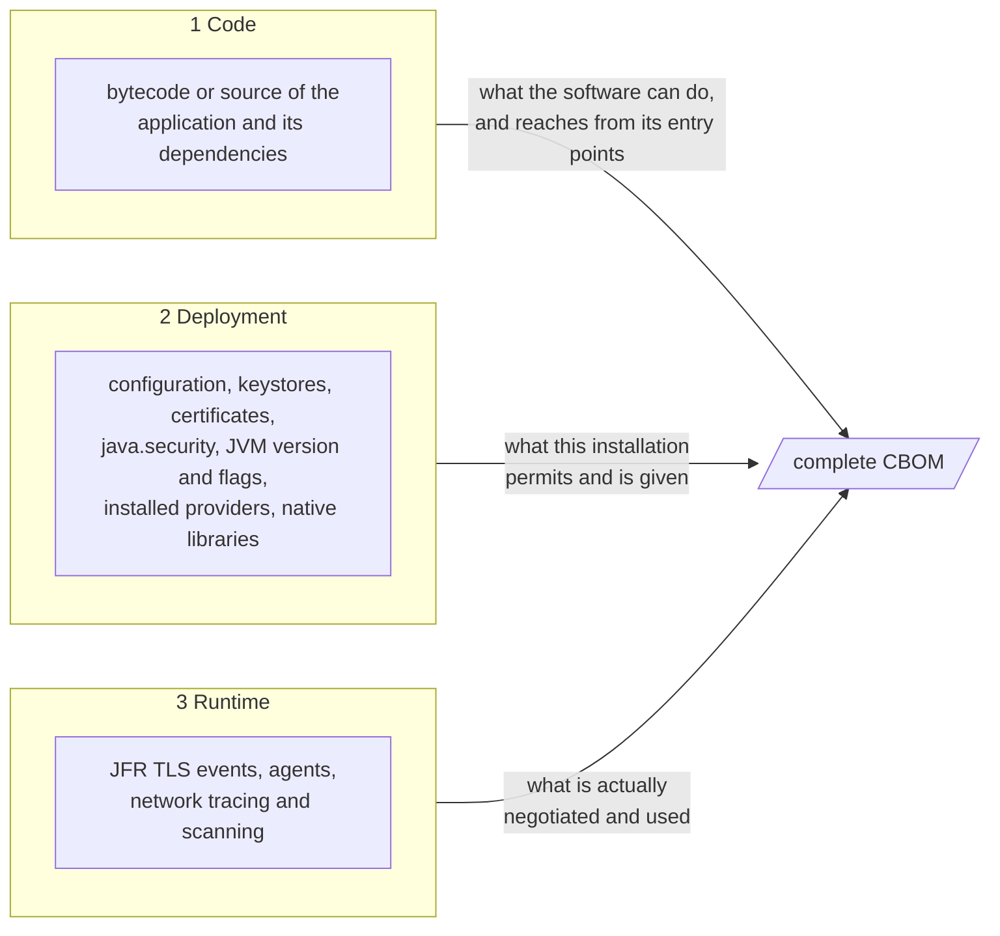
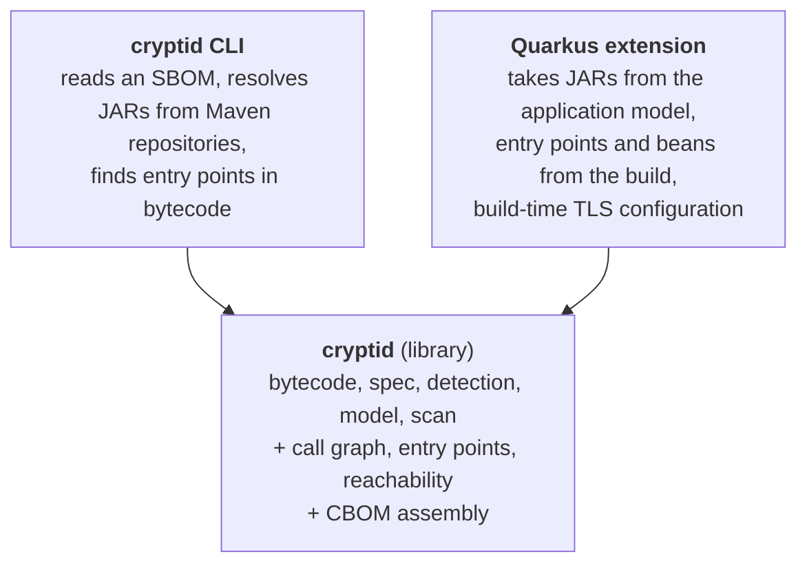

# Reachability, and what cryptid covers of a complete CBOM

Status: design, agreed in outline on 2026-11-15, not implemented. Sections marked *(open)* need a decision before or during planning.

## Why

cryptid reports every use of a cryptographic API in every JAR of an SBOM. That is an inventory of what is *present*. Most of it is never run by the application: a library's unused code paths, alternative providers, tools bundled in a distribution. A reader planning a migration can't tell which of Keycloak's 2,589 occurrences matter.

This design moves cryptid from presence to *reachability*: every finding stays in the CBOM, and each is marked as reached from an entry point of the application or not. It also places cryptid within the larger task of producing a complete CBOM, most of which no bytecode analysis can do, and splits the project into a library, a CLI and a Quarkus extension.

## A complete CBOM

A CycloneDX CBOM lists cryptographic assets of four types, and the relations between them and the software components using them (`dependsOn`: uses; `provides`: implements).

| Asset type | Examples | Where the facts are |
| --- | --- | --- |
| algorithm | AES-256-GCM, SHA-256, ML-KEM-768, with primitive, mode, padding, parameter set, functions | code: the API calls choosing them; configuration: names passed in at deployment |
| related crypto material | keys, IVs, salts, passwords, tokens: type, size, state, how they are secured | code: generation and derivation calls; deployment: keystores, HSMs, secrets |
| certificate | subject, issuer, validity, signature algorithm, key | deployment: keystores, PEM files, trust stores; runtime: what peers present |
| protocol | TLS, SSH, IPsec: version, cipher suites, key-exchange groups, linked certificates | code: what the application pins; deployment: `java.security`, system properties, framework configuration; runtime: what is negotiated with each peer |

No single source has all of it. There are three, and each bounds the next:

1. **Code** says which cryptography the software is written to use: the algorithms and parameters its calls choose, the keys it generates, the protocol versions and suites it pins. Bytecode and source carry nearly the same facts for Java; bytecode needs no sources and covers every dependency. Within code there are two levels: *presence* (the call exists in an artifact) and *reachability* (a static call path leads to it from an entry point).
2. **Deployment** says what a given installation permits and is given: certificates and keys, disabled algorithms, default and configured TLS groups, the JDK's defaults (e.g. hybrid post-quantum key exchange enabled by a JDK update without any change to the application), providers and native TLS engines.
3. **Runtime** says what is used: the protocol version, suite and group negotiated with each peer, the certificates presented, the code paths exercised.

### What cryptid covers

cryptid is the code source, from bytecode.

| | Presence | Reachability | Deployment | Runtime |
| --- | --- | --- | --- | --- |
| algorithm | today | this design | no | no |
| related crypto material (as created by code) | today | this design | no | no |
| protocol (as pinned by code: `SSLContext.getInstance`, enabled protocols and suites) | today, for the JSSE APIs in the specs | this design | only what the Quarkus extension knows at build time | no |
| certificate | no | no | no | no |

What a cryptid CBOM can and can't claim:

- "Reached" means a static call path exists from a known entry point. It doesn't mean the path runs.
- "Not reached" means no path was found. Reflection, and entry-point kinds cryptid doesn't know, leave real paths undiscovered.
- A value the code doesn't fix (an algorithm name read from configuration) isn't in the CBOM.
- Nothing about negotiation, certificates or the JVM the application runs on.

A complete CBOM merges cryptid's output with a deployment scan and runtime evidence. Producing or merging those is out of scope.

## Goals

- Mark every finding as reached from the application's entry points or not, with the entry point as evidence.
- Find entry points in bytecode from specifications kept as data: REST endpoints, message handlers, scheduled methods, CDI observers and startup hooks, `main`.
- Accept entry points and instantiated classes as data from whatever built the application, so that a Quarkus build can supply what it knows.
- Provide the analysis as a library with two front ends: the CLI (SBOM in, CBOM out) and a Quarkus extension (CBOM of the application being built).
- Close the detection gap for crypto APIs used as method references, which falls out of the call graph work.

## Non-goals

- Deployment and runtime scanning, certificates, merging CBOMs from other sources.
- Network sockets as findings.
- A CBOM for Quarkus as a product. It has no application and so no entry points; what to record for it is undecided. The per-artifact presence results cryptid produces today are the nearest fit.
- A general-purpose bytecode analysis library. Tree-shaking and vulnerability reachability don't shape this design. The call graph stays free of crypto knowledge so that such reuse remains possible.
- Following branches within a method: a finding is reached when its method is.

## Anti-goals

- Dropping findings. Unreached findings stay, marked.
- Marking everything "not reached" when no entry point was found. That is "unknown", and must be reported as such.
- Reporting reachability without saying which entry-point kinds were searched for.

## Deliverables

**Library.** Everything except obtaining the JARs: analysis, detection, modeling, reachability and assembling the CBOM. Its input is a set of artifacts (JAR, coordinates, dependencies), which of them are top-level, and optional entry points and instantiated classes as data. It has no dependency on Quarkus or CDI. Today `CbomAssembler` is a CDI bean and assembly is driven by the SBOM's components; both change.

**CLI.** What `GenerateCbomCommand`, `SbomReader` and `ArtifactResolver` do today, on top of the library. It remains a Quarkus application.

**Quarkus extension.** A separate project, after the library and CLI work on Keycloak. At build time it has what the CLI has to guess: the application's artifacts, the endpoints, channels, scheduled methods and gRPC services Quarkus wires, the beans left after unused-bean removal, and the TLS and keystore configuration. It passes those to the library and writes the CBOM as a build output, next to the SBOM of Quarkus's CycloneDX extension. Build-time configuration can be overridden at runtime, so this bounds the deployment source without replacing it. Name *(open)*: `quarkus-cbom` or `quarkus-cryptid`.

**Publishing.** An extension others can use needs the library on Maven Central. The library depends on sonar-cryptography modules, which aren't there and must be built locally, against the SSAL analyzers. [The dependency on sonar-cryptography](#the-dependency-on-sonar-cryptography) below resolves that. It doesn't block the reachability work.

## The dependency on sonar-cryptography

cryptid uses sonar-cryptography's crypto knowledge, not its analysis. Ten main classes use its types, all in `detection`, `model` and `scan`. By module, from the 1.7.0 JARs (references to SonarSource types counted in the class files):

| Module | Classes | What cryptid uses | Classes referencing SonarSource types |
| --- | ---: | --- | ---: |
| `mapper` | 399 | the crypto model (about 250 classes: algorithms, modes, paddings, curves), the name parsers for JCA, Bouncy Castle and TLS suites, the reorganizer | 0 |
| `enricher` | 21 | OIDs, default key sizes, functions | 0 |
| `output` | 17 | the model to CycloneDX | 0 |
| `engine` | 201 | about 70 value, context and factory classes | 0 of those 70; 36 elsewhere |
| `java` | 168 | 11 context translators and the list of reorganizer rules, loaded by reflection | 158, the translators among them |

That splits into a part that is easy to replace and a part that isn't worth rewriting.

**`java` and `engine`: replaced by cryptid's own code.** The 70 `engine` classes are data carriers ("this string is an algorithm name in a cipher context"), which `ValueFactories` and `CryptoContexts` already wrap one for one; records replace them. The 11 translators decide which name parser a value in a context goes to: a few hundred lines of dispatch. The rest of `java` is the detection rules, which the specs replaced. Removing the two modules removes what is awkward about the dependency: the reflection in `CryptoAssetModeler`, the stand-in `org.sonar.plugins.java.api.tree.Tree`, the exclusions in `pom.xml`, and the local build against the SSAL analyzers. `FixtureConformanceTest` guards the change. The rule-based reference in the tests (`PipelineEquivalenceTest`, `RuleSpecDriftTest`, `RuleSpecExporter`) still needs those modules; whether it is kept as a test-only dependency or retired with its baseline frozen is *(open)*.

**`mapper`, `enricher`, `output`: their sources copied into cryptid.** These 437 classes are the knowledge base: what `"AES/GCM/NoPadding"` or `SHA256WithRSAEncryption` means, its OID and default key size, and its CycloneDX form. Rewriting it means re-deriving a taxonomy of a few hundred algorithms and matching today's output finding by finding, for no gain in function. The modules are Apache-2.0, reference no SonarSource type, and otherwise need only CycloneDX, slf4j, commons-lang3 and gson. So their sources go into a module of cryptid, with their license headers and an updated NOTICE, and a POM of its own (upstream's parent POM declares the analyzers for every module). The Go and Python mappers are left out.

- The cost: upstream additions (new algorithms, fixes) are merged by hand.
- Not verified yet: that the three modules' sources build without the rest of sonar-cryptography. Only the binaries were checked.
- The alternative, asking the sonar-cryptography project to publish the three modules to Central, keeps cryptid on their releases but depends on them. Worth asking in any case.
- Later, the copied model becomes data, the direction the API specs took ([detection-redesign.md](detection-redesign.md)), a piece at a time behind the conformance tests, in the vocabulary of the CycloneDX registry (next section).

After both steps the library has no dependency outside Maven Central.

## Shared data

Most CBOM generators keep their own crypto knowledge. sonar-cryptography's model is public, but as Java classes and hand-written parsers, not as data another tool can load. SCANOSS's crypto-finder fetches its own curated rules; Mondoo's xgrep has its own rules and classification. (cdxgen and the CodeQL-based generators weren't checked.)

The exception is the algorithm taxonomy. CycloneDX 1.7 introduced a [Cryptography Registry](https://cyclonedx.org/registry/cryptography): algorithm families with their standards and variants, and elliptic curves, as JSON ([schema](https://cyclonedx.org/schema/cryptography-defs.schema.json)), maintained apart from the specification so that it grows without a release of it. A [report of February 2026](https://toscalix.com/wp-content/uploads/2026/02/spdx-cryptographic-algorithm-list-report-2026-02-17.pdf) counts 80 families and 254 curve variants in it, and describes a list SPDX maintains as well.

The data cryptid needs is in four layers, with different owners:

| Layer | Example | Shared home today | In cryptid |
| --- | --- | --- | --- |
| algorithm taxonomy | AES is a block cipher; its variants, OIDs, parameter sets | the CycloneDX registry | `mapper`'s model classes, `enricher` |
| provider naming | JCA's `"AES/GCM/NoPadding"`, Bouncy Castle's aliases, TLS suite names | none; IANA for TLS suites | `mapper`'s parsers, the `names` section of the specs |
| API specs | which argument of `Cipher.getInstance` carries what | none; CrySL's rule sets are the nearest, written for misuse detection | `crypto-api-specs.yaml`, 515 APIs |
| entry points, instantiated classes | `@GET` marks a REST endpoint | none; not specific to crypto | this design |

What follows for cryptid:

- **No project of its own for the taxonomy.** It would be a third list beside CycloneDX's and SPDX's. cryptid's model aligns with the CycloneDX registry: when the copied `mapper` model becomes data, it uses the registry's family and variant names, and what the registry lacks is contributed there. The long-term state of the copied sources is then "generated from, or checked against, the registry", not a fork maintained by hand.
- **The Java layers are a real gap**, and `crypto-api-specs.yaml` is already a public dataset of that kind. A separate project pays off with a second consumer or contributor; with cryptid as its only user it is release and compatibility overhead. So the data (API specs, name tables, entry-point and bean specs) is kept in a module of its own, with a documented schema and no dependency on code, and moves to a repository of its own when someone else wants to use or contribute to it. The CBOMkit maintainers are the first to ask: specs as data would serve them too.
- **Not checked yet:** how much of what `mapper` models (modes, paddings, default sizes, OIDs) the CycloneDX registry covers. That comparison decides how far the alignment can go.

## Reachability

### Top-level artifacts

The top-level artifacts are the application's own code; entry points are searched for only there. The user names them, by coordinates with wildcards, e.g. `org.keycloak:*`.

The default is the direct dependencies of the SBOM's metadata component. It is weak: in the Keycloak distribution's SBOM those are 75 artifacts, mostly libraries such as `maven-core` and `gson`, while Keycloak's own code sits behind one of them, `keycloak-quarkus-server-app`. The CLI logs the top-level artifacts it uses, and the documentation recommends naming them.

### Entry points

An entry point is a method something outside the analyzed code calls. They are specified as data, like the crypto APIs, in four forms:

| Form | Matches | Examples |
| --- | --- | --- |
| annotation | methods carrying an annotation, or all public methods of a class carrying one; annotations inherited from overridden interface methods count | JAX-RS `@GET`, `@POST`, … (`jakarta` and `javax`); Spring `@RequestMapping` and its variants; `@Incoming`; `@Scheduled`; `@ConsumeEvent`; `@Startup`; `@WebServlet` |
| parameter annotation | methods with an annotated parameter | CDI `@Observes`, `@ObservesAsync` |
| override | methods overriding a method of a given type | `HttpServlet.doGet` …; gRPC `BindableService` implementations; `MessageListener.onMessage`; `QuarkusApplication.run` |
| signature | methods by name and descriptor | `public static void main(String[])` of the class in the manifest's `Main-Class`; without a manifest entry, every `main` in the top-level artifacts |

Each spec has a kind (`rest`, `messaging`, `scheduled`, `lifecycle`, `main`, …) and, where it can be read from the annotation, a label for the evidence, e.g. `POST /realms/{realm}/…`. Any method with an HTTP-method annotation is an entry point, whether or not its class has `@Path`: that covers JAX-RS sub-resources without modeling locators, at the cost of an incomplete path in the label.

Routes registered in code (`router.get("/x").handler(...)`) are call sites taking a lambda, not annotated methods. They need a fifth form, "the function passed to this API", and are left for after the first version.

**Entry points as data.** The library also accepts a list of entry points (method, kind, label) from its caller. Those can be in any artifact, and replace or add to detection as the caller chooses. This is the Quarkus extension's input. For the CLI, a file in the same format *(my call: a `--entry-points` option)*.

### Instantiated classes

A call on an interface or a non-final class is taken to reach only the implementations the application can have an instance of (below). Code instantiates most of them with `new`, which the analysis sees. Three kinds of objects are created by something else, and need rules of their own:

- **Service providers**: classes named in `META-INF/services` of any analyzed JAR count as instantiated. Keycloak's providers are loaded this way.
- **Beans**: classes with a bean-defining annotation (`@ApplicationScoped`, `@Singleton`, `@RequestScoped`, `@Dependent`, Spring's `@Component` family, …) count as instantiated, in any analyzed JAR. These are specs as well, separate from entry points: such a class's methods are reached only if something calls them.
- **Entry-point classes**: the class declaring a reached entry point counts as instantiated.

The caller can supply the instantiated classes as data too; a Quarkus build knows the exact set of beans.

Objects created by reflection elsewhere (`Class.forName(name).newInstance()`) aren't found. `Analyzer` already resolves constant strings; using that for class names is a later refinement.

### Call graph

For every analyzed method: the methods it calls, the classes it instantiates, and the method handles it creates (lambdas and method references, from `invokedynamic` bootstrap arguments and `ldc`). Built across all JARs of the SBOM, in the `bytecode` package, with no reference to crypto specs.

Reachability is a forward walk from the entry points:

1. A reached method's static, special and constructor calls reach their targets, resolved to the declaring class as `CallIndex.declaring` does today.
2. A virtual or interface call to `T.m` reaches `m` in every instantiated subtype of `T` that declares or inherits it. The set of instantiated classes grows as methods are reached, so this runs to a fixpoint.
3. A method handle created in a reached method reaches its target: the lambda's body, or the referenced method. This over-approximates slightly (the function may never be invoked) and needs no model of where it is passed.
4. A reached class's static initializer is reached; a reached constructor reaches its superclass's.
5. Calls into classes outside the SBOM (the JDK) end there. A JDK method calling back into application code is covered by rule 2 for overrides of JDK types (`Runnable.run`, `Comparator.compare`): an instantiated class's overrides of methods declared by a type outside the SBOM are reached. *(My call: without this, everything run through an executor or a collection is lost.)*

For each reached method the walk keeps the entry point it was first reached from and its predecessor, which gives one path per method, the first found, in a breadth-first order, so a shortest one.

A finding is reached when the method containing its occurrence is. Where a value was resolved at a caller, the occurrence is located at that caller's call site, and the caller's method decides.

### In the CBOM

CycloneDX has no place for reachability on an occurrence: an occurrence has a location, a line and `additionalContext`, and a component has one `callstack` for all its occurrences. So *(my call)*:

- Every occurrence gets a `bom-ref`.
- Every crypto asset gets a property `cryptid:reachability`: `reached` if any of its occurrences is, `not-reached` if none, `unknown` if reachability wasn't computed (no entry points found, or the analysis was disabled).
- For every reached occurrence, the asset gets a property `cryptid:reached` whose value is the occurrence's `bom-ref`, the entry point's kind and its label or method.
- The CBOM's metadata records the top-level artifacts, the entry-point kinds searched for and the number found of each, as properties.
- The full path from entry point to occurrence goes to a separate file on request (`--paths`), not into the CBOM: at thousands of occurrences it would dominate it.

The property names, and whether the path belongs in the CBOM after all, are *(open)* for review once there is real output to look at.

The CLI's summary line gains the counts: findings reached, not reached.

## Changes this needs in `bytecode`

From the review of the package:

| Today | Change |
| --- | --- |
| `CallIndex` keeps only calls with a `String` or `int` argument of known provenance; it answers "which constants reach this parameter" | a full call graph beside it; the value index stays as it is |
| `Analyzer.invokeDynamic` handles string concatenation only | record the bootstrap method handles: lambda bodies and method references become edges, and a method reference to a crypto API (`MessageDigest::getInstance`) becomes a call site detection can match |
| annotations aren't read | read class, method and parameter annotations for the entry-point and bean specs |
| instantiations (`new`) are tracked per method as object origins only | also recorded per method as the class instantiated |
| `META-INF/services` isn't read | read per JAR by `JarCache` |
| methods are identified by concatenated strings (`owner.name+descriptor`) in every map | a compact method identity for the graph; a whole-program graph of Keycloak (83,000 classes) in string keys won't fit the memory budget |
| methods that fail to interpret are counted and otherwise ignored | their calls are still needed: the call graph is taken from the instructions directly, not from the interpretation, so a failure loses values but not edges |
| per-artifact results cached in `--work-dir` are CBOMs; phase A is skipped when everything is cached | reachability depends on the whole SBOM and the top-level artifacts, so it can't be cached per artifact. Each artifact's graph facts (edges, instantiations, annotations matched, services) are cached per artifact; the walk runs on every invocation |
| occurrences don't record their enclosing method | they must, for assembly to look up reachability |

Two findings of the review that this design does *not* address, because presence and reachability of crypto don't need them: partially known values look fully known (`AVal.merge` of a constant with an unknown value keeps the constant), and field and return-value fixpoints stop at the JAR boundary. Both matter to tree-shaking, should that be taken up.

## Constraints

- Java 17; no SonarSource analyzer, as now ([Licensing](../README.md#licensing)).
- `bytecode` and `spec` don't use sonar-cryptography types, as now. The call graph and the entry-point matching don't know about crypto.
- Results are the same in every run (`ReproducibilityIT`), including which path is reported for a finding.
- Findings, apart from the new marking and the method-reference call sites, don't change: `FixtureConformanceTest` and `PipelineEquivalenceTest` keep passing.
- Keycloak's SBOM takes about 20 seconds and 5.5 GB today. The target with reachability *(my call)*: under a minute, and within the same heap.

## Order of work

Each step is testable alone, and the Keycloak SBOM is the measure throughout.

1. **Call graph.** Full edges, instantiations and method handles across all JARs. Measure: time and memory on Keycloak; method references to crypto APIs appear as findings.
2. **Entry points and instantiated classes.** The specs, annotation reading, `META-INF/services`. Measure: the entry points found in `org.keycloak:*` by kind, checked against Keycloak's known REST endpoints.
3. **Reachability and the CBOM.** The walk, the marking, the summary. Measure: the share of the 2,589 occurrences reached, and a manual check of a sample of both outcomes; a not-reached finding that is in fact used points at a missing entry-point or instantiation rule.
4. **Library and CLI split.** Module structure, assembly without CDI, artifacts as input in place of SBOM components.
5. **sonar-cryptography.** Own code for `java` and `engine`; the sources of `mapper`, `enricher` and `output` as a module. Measure: the fixture baseline and the Keycloak CBOM don't change; the build needs nothing outside Maven Central.
6. **Quarkus extension.** A separate design, once 1 to 5 hold up.

Steps 1 to 3 can be done in the current single module; 4 before or after them. *(My call: after, so that the library's API is shaped by a working implementation.)* Step 5 is independent of 1 to 4 and can be done at any point before the library is published.

## Decisions and calls

Decided by the project owner:

- The CBOM distinguishes reached crypto from present crypto; unreached findings are kept and marked.
- Entry points decide reachability, to avoid over-reporting; not "all code of the top-level artifacts is live".
- Top-level artifacts are named by the user; the default is the metadata component's direct dependencies, with the manifest's `Main-Class` identifying the `main`.
- A shared library, a CLI and a Quarkus extension.
- No general-purpose analysis library for now.
- The dependency on sonar-cryptography is resolved by replacing `java` and `engine` and copying the sources of `mapper`, `enricher` and `output`.

Calls made while writing this, to confirm or change:

- Interface and virtual calls reach instantiated implementations only, with service providers, beans and entry-point classes counted as instantiated.
- Overrides of JDK-declared methods in instantiated classes are reached.
- A method handle's target is reached when the handle is created.
- Entry points are detected in top-level artifacts only; supplied ones can be anywhere.
- The CBOM encoding: properties on assets, paths in a separate file, an `unknown` state.
- The performance target, and the order of the library split.
- Shared data: align with the CycloneDX registry, keep the data in a module of its own, and no separate project until there is a second consumer.

Left to the implementer: the format of the entry-point and bean specs and their initial contents beyond the examples above, the representation of the graph, the cache format, the module names.
